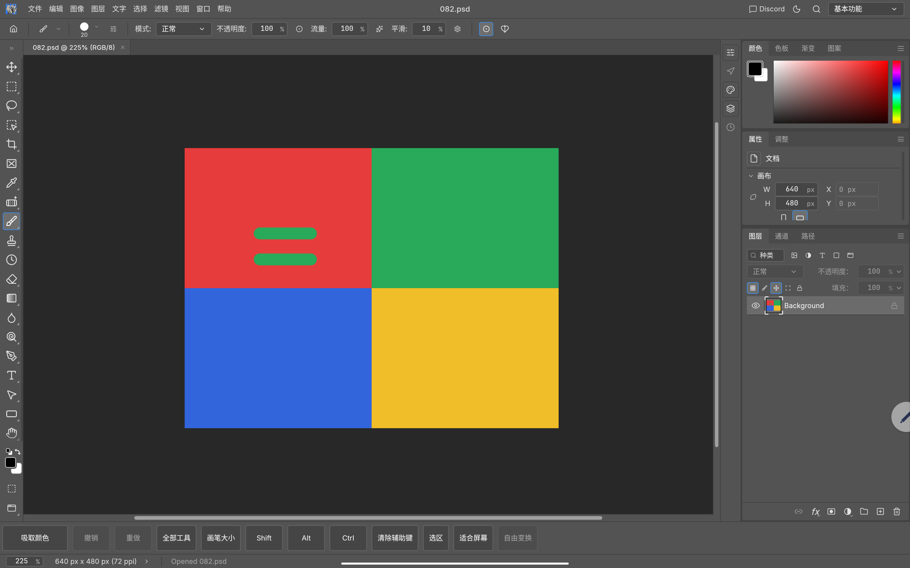
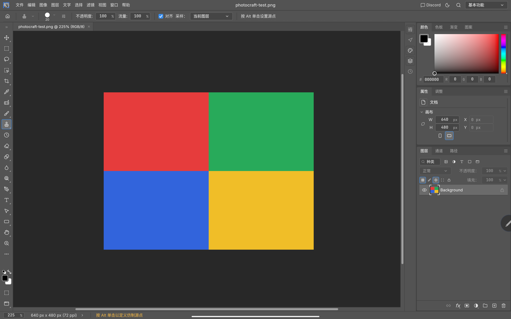
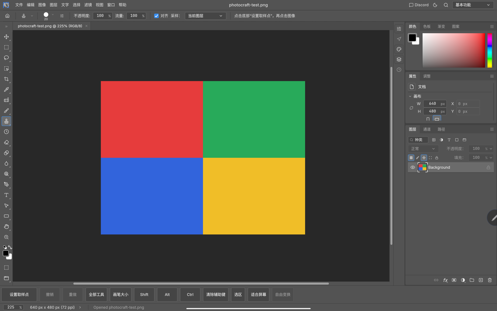
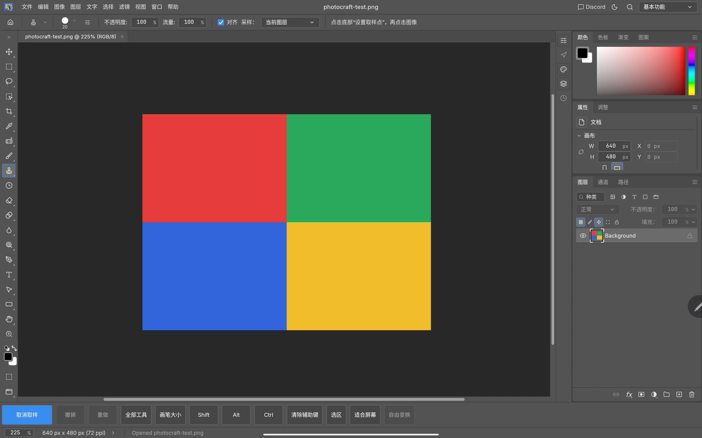
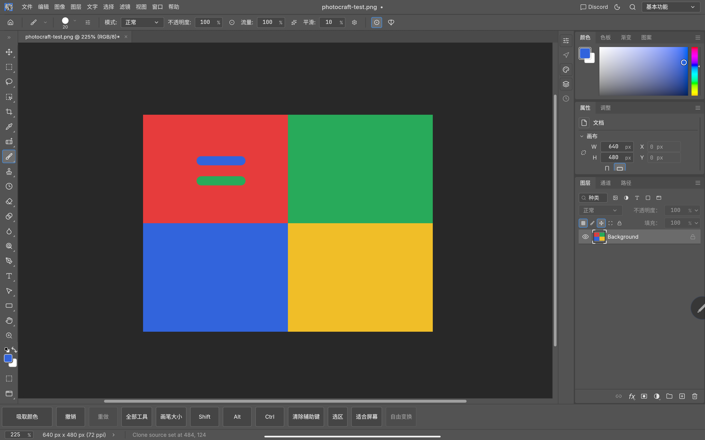
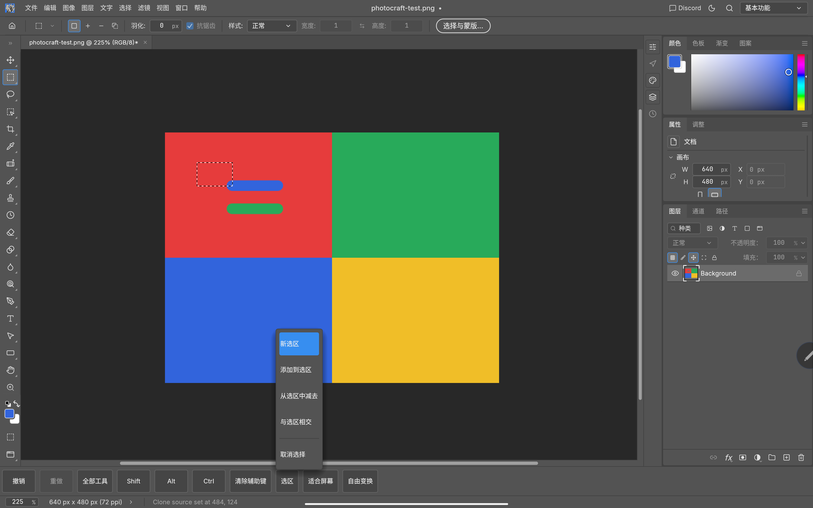
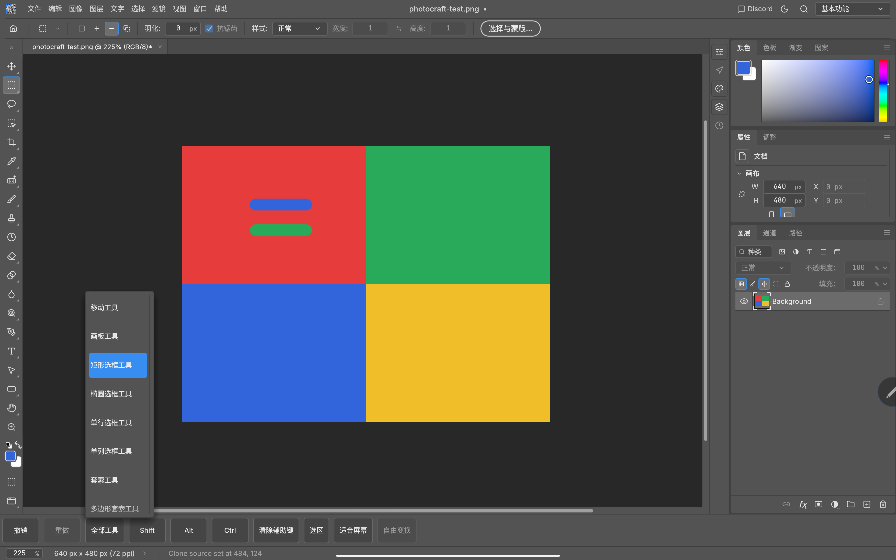
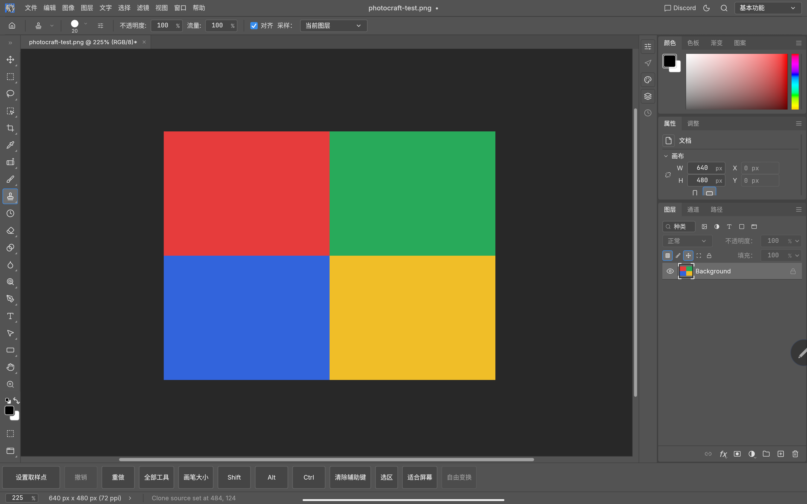

# PhotoCraft Android: keyboard-free touch tools

Updated 2026-10-13 · Community build **0.8.2-android-alpha.4** · Contributor **@HubWithTorch**

Clone Stamp and Healing previously asked for Alt-click to set a source. A tablet user
without a keyboard could select the tool but could not start retouching. Android now
enables a bottom touch tray with one-shot sampling and larger controls for common actions.
The same shared Rust UI remains optional on desktop, under Window > Modifier Keys > Touch Controls.

Download the [0.8.2 community APK and checksums](https://github.com/HubWithTorch/photocraft/releases/tag/android-v0.8.2-alpha.4).
The historical [alpha.3 release](https://github.com/HubWithTorch/photocraft/releases/tag/android-v0.7.0-alpha.3) remains available.
This is an experimental community release, not an official upstream Android release.
The new alpha.4 release uses upstream 0.8.2 with the same file and touch fixes.
Screenshots below remain the original alpha.2/alpha.3 device comparison, not new-build evidence.
See [migration boundaries and build tools](android-porting.md).

## 0.8.2 update / 新版验证
+
+Alpha.4 is based on upstream 0.8.2 (24930b31) and keeps the same package and signing
+certificate as alpha.3. It was installed over the existing app without clearing data.
+ADB repeated source sampling, clone painting, Undo/Redo, system-picker PNG import,
+PSD Save As, repeated Save and Files cold-open on 2026-10-13. The saved test PSD grew
+from 49,166 to 50,521 bytes after a second stroke; both strokes survived reopening.
+
+| Clone sampling on 0.8.2 | Files cold-open restores both saved strokes |
+|---|---|
+|  |  |
+
+Current validation: **2545 UI tests passed, 12 ignored**; **2 Android file-service tests**;
+**3387 corpus tests passed, 27 ignored**, across 151 binaries. Host/Android clippy,
+layers, wasm, scoped formatting and three catalog-port tests passed. The migration
+bundle was applied to a clean upstream index and its 20 catalog deltas checked against
+the source. Corpus validation used a faster local LTO-disabled profile; the APK used
+the default release profile. See [the porting guide](android-porting.md).
+
+## Before and after / 修复前后

Both captures use the same synthetic image on a Lenovo TB378FC, Android 16, at 225% zoom.
The original is alpha.2; the updated image is the installed alpha.3 APK.

| Before: Alt required, drawing cannot start | After: touch sampling produces a green clone stroke |
|---|---|
|  |  |

## Clone Stamp and Healing / 仿制图章与修复画笔

1. Select Clone Stamp or Healing.
2. Tap **Set Sample Point / 设置取样点** in the bottom tray.
3. Tap the source in the image. The button temporarily reads **Cancel Sampling / 取消取样**.
4. Draw at the destination. Drawing resumes automatically; no modifier key stays pressed.
5. Tap Set Sample Point again whenever a new source is needed.

取样时只需点“设置取样点”→点图像中的来源→在目标处绘制。无需外接键盘或一直按住 Alt。
点到图像外会保留取样状态；可点“取消取样”退出。

| Sampling controls | Armed for the next source tap |
|---|---|
|  |  |

Sampling must not paint. An event-sequence regression test catches the duplicate press
that egui can emit on click release: the source tap leaves both document revision and
clone offset unchanged. A missing release is recovered at the next physical press.

## Other touch workflows / 其他触屏操作

| Task | Touch operation | Validation |
|---|---|---|
| Undo / redo | Dedicated bottom buttons | ADB: clone stroke disappears and returns |
| Pick a foreground color | Brush/Pencil/Gradient/Bucket: Pick Color Once, then tap the image | ADB: sampled blue, painted blue |
| Change brush size | Brush Size opens a larger slider and 5/20/50/100 presets | ADB: selected 100 px |
| Access grouped tools | All Tools opens a scrollable tool list | ADB: menu opened; screenshot below |
| Combine selections | Selection menu: new, add, subtract, intersect, deselect | ADB: add a second rectangle, subtract a hole, deselect |
| Modifier-dependent actions | Tap Shift, Alt or Ctrl to latch; Clear Modifiers releases all | Automated: virtual Ctrl selects multiple layer rows |
| Finish an edit | Contextual commit/cancel for crop or transform; close polygon selection | Implemented; device verification pending |
| Recover hidden panels | Show Panels remains available in the touch tray | Implemented; device verification pending |

Modifiers clear when changing tools or losing focus. For retouching, the one-shot source
button is preferable to latching Alt. Selection modes reuse the existing selection behavior.

| Brush size | One-shot color sampling and painting |
|---|---|
|  |  |

| Selection modes | Added selection and subtracted hole |
|---|---|
|  |  |

## Verification and remaining work

The screenshots were captured through ADB on 2026-10-12 from a synthetic 640 × 480
four-color image. No personal images are published. For the clone test, physical
screenshot pixel `(1100, 900)` was green `(40,170,90)` after painting, red `(230,60,60)`
after Undo, and green again after Redo. These are screenshot coordinates, not document pixels.

| Undo | Redo |
|---|---|
|  |  |

On the released 0.7.0 source: UI unit suite **1960 passed, 10 ignored**, including seven
new touch-control tests. Three canvas gesture tests, host and Android clippy, dependency
layers and WebAssembly checks passed. The Android release build completed and was installed
on the tablet. The quick layout performance run completed; it does not establish tablet
frame-time performance or a new performance baseline.

The previous file-provider fix remains included: system-picker open, PSD Save As,
repeated Save, and opening a saved PSD from Files were verified on this tablet in alpha.2.
See [Android development notes](../apps/photocraft-android/ANDROID_DEV.md).

Two-finger zoom/pan has automated coverage; physical gesture feel still needs manual
confirmation. Phone portrait layout, small controls outside the tray, stylus axes and
the long tail of desktop dialogs remain incomplete. Host Basic Render Driver GPU failures
from the earlier validation are recorded in the development notes, not claimed to pass.

All screenshots are original device captures. [Asset provenance and licenses](images/android-touch/README.md).
